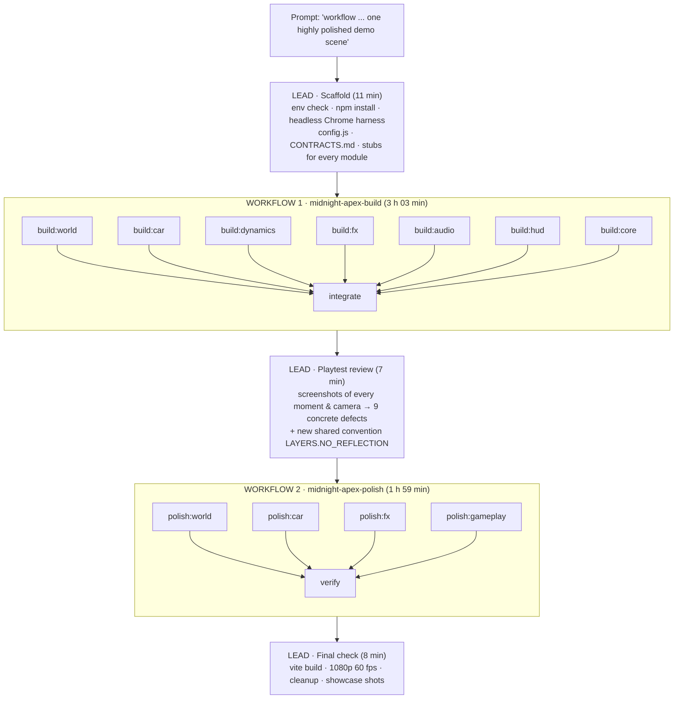

# MIDNIGHT APEX — how the game was built

> **Prompt:** `workflow Create a hyper-realistic NFS-inspired racing game (one highly polished, fully playable demo scene)`
> **Built by:** one Claude Code session (the *lead*) orchestrating 13 subagents through two Workflow runs.
> **Model:** `claude-opus-5-5` everywhere, the lead and all subagents alike.
> **Wall clock:** about 5 h 30 min, 2026-10-04 23:07 → 2026-10-05 04:35 (UTC+5).
> **Result:** a rain-soaked neon downtown street race at night. You race 4 AI rivals over 3 laps on a 2.9 km circuit, from menu to results screen. It runs at 60 fps at 1080p on an M2 Pro. Every mesh, texture, sound and music track is generated in code.

The same information in machine-readable form is in [`process.json`](process.json). Each subagent's full structured report and metrics are in [`agent-reports/`](agent-reports/). The two orchestration scripts, exactly as they ran, are in [`workflows/`](workflows/).

---

## 1. The process at a glance

| Phase | Local time | Who | Output |
|---|---|---|---|
| Scaffold | 23:07–23:18 | lead | Working project skeleton: test harness, contract, stubs |
| Build | 23:18–01:31 | 7 builders in parallel | Seven real modules replacing the stubs |
| Integrate | 01:31–02:20 | integrator | One coherent game; full race from menu to results; 60 fps |
| Review | 02:21–02:28 | lead | Nine-item defect list with screenshots; new render-layer convention |
| Polish | 02:28–03:51 | 4 polishers in parallel | Fixes for the 9 defects |
| Verify | 03:51–04:27 | verifier | Regression pass, 3-lap race, performance, docs |
| Final check | 04:27–04:35 | lead | Build, runtime check, cleanup, delivery |

---

## 2. Reading the request

- **`workflow`** was the user's explicit opt-in to multi-agent orchestration with the Workflow tool, which only runs when the user asks for it. The lead loaded the workflow-authoring reference before writing anything.
- **"one highly polished, fully playable demo scene"** set the scope:
  - **Narrow:** one race, one hero car, four rivals, three laps.
  - **Deep:** AAA-level visuals and feel.
  - **Complete:** menu → intro → countdown → race → results, plus pause and restart.
- **"hyper-realistic NFS-inspired"** chose the setting: a rainy neon city at night, as in NFS Underground and Heat. That look is also the one a browser renders most convincingly:
  - darkness hides geometric simplicity;
  - wet-asphalt reflections, emissive neon, bloom and fog carry most of the realism cheaply.

Not added on purpose: police chases, traffic, an open world, a garage, car customisation. Polish is an attention budget, and every extra system takes from it.

---

## 3. Principles and decisions

1. **Contract before agents.** The lead wrote `CONTRACTS.md` before any subagent existed. It fixes:
   - every module's exported API;
   - units, the Y-up flat world, and sign conventions: heading 0 faces +Z, steer +1 turns right so heading decreases, car-local +X is the car's left, track lateral + is right, curvature + bends right;
   - the colour pipeline: ACES tone mapping, sRGB output, `OutputPass` last;
   - the performance budget (60 fps at 1080p on M2 Pro) and the test harness;
   - one owner per file.

   This let seven agents build in parallel without reading each other's code.
2. **Working stubs for every module.** Crude but contract-compliant stubs went in for track, environment, car, physics, AI, post-fx, particles, rain, audio and HUD. Every import resolved from the start, so the core agent could run the whole game while the others were still writing, and real modules hot-swapped in.
3. **Strict file ownership instead of merging.** Agents only write their own files, so there were no conflicts and no git worktrees. Only the integrator and the verifier may touch everything.
4. **Every agent sees its own output.** Each builder made a bench page for its module (`dev/<module>.html`) and used `scripts/shot.mjs`, a headless-Chrome harness on the real GPU. Agents iterated "build → screenshot → look → fix" many times; the car agent alone made about 215 tool calls.
5. **Objective checks automated, taste checked by eye.**
   - Automated: the build passes, a full autopilot race reaches the results screen, fps, console errors, and Node tests for physics and AI (0–100 km/h, top speed, braking, lateral g, a 5-car 3-lap AI race).
   - By eye: screenshots at real resolution, judged against a modern AAA racing game.
6. **One workflow per phase, lead in the loop.** The lead did not pre-plan every round. After each workflow it read the reports, played the build through screenshots, and chose the next phase from what it saw.
7. **Polish is its own phase, driven by a defect list.** The second workflow did no new features, only 9 specific defects, each with a screenshot and an owner.
8. **Cross-module conventions go through the contract.** When flames, sparks and particles had to stay out of the wet-road reflection, the lead added `LAYERS.NO_REFLECTION` to `config.js` and `CONTRACTS.md` *before* the polishers started. The car, fx and world agents then each did their part in their own files.
9. **Everything procedural, no external assets.** Nothing to download, license or fail to load, and one art direction controlled in code. The trade-off is a realism ceiling on the car mesh and the engine sound.
10. **Minimal, honest test hooks.**
    - `window.__game` exposes telemetry, and URL params control `autostart`, `autopilot`, `laps`, `timescale`, `quality`, `ai`, `mute` and `nofx`.
    - Autopilot is the same `AIDriver` the rivals use. It drives the automated tests and serves as the menu's attract mode.
11. **Effort and model.** Subagents inherited the session model (Opus 5.5); builders, integrator, polishers and verifier ran at `effort: 'high'`.

---

## 4. Scaffold (lead, 11 minutes)

| Step | Decision and why |
|---|---|
| Environment check | Node 24 and an Apple M2 Pro. Google Chrome was installed but Playwright's browsers were not, so the lead used `playwright-core` with `channel: 'chrome'`: no browser download. |
| `npm install three vite playwright-core` | three.js r186 with WebGLRenderer, chosen over WebGPU for stability. Vite gives instant hot reload, which the shared dev server depends on. |
| `scripts/shot.mjs` | A test harness every agent shares, with steps for key down/up/hold, click, eval, fps and screenshots. It prints console messages, page errors and failed requests. A smoke test confirmed WebGL2 at 60 fps headless. |
| Port 5391 | Port 5173 was serving another local project, and the first smoke test captured *that* app. The lead switched to 5391 with `--strictPort` and told all agents never to use 5173. |
| `src/config.js` | Shared constants every module needs: car dimensions so the model, physics and collisions agree, liveries, road width, race settings, URL params, math and heading helpers. |
| `CONTRACTS.md` | 11 module contracts, a file-ownership table and the test harness. Later amended with the `createTrackPath()` Node-safe API (so AI can be tested in Node) and the render-layers section. |
| Stubs | An oval track, a box car, a kinematic car model, a centreline-following AI, plain post-fx, no-op particles/audio and a text HUD. All verified to import and run. |

---

## 5. Workflow 1 — `midnight-apex-build`

**Shape:** `parallel(7 builders)` → barrier → `integrate`. The barrier is justified because integration needs every module finished. Script: [`workflows/01-build.workflow.js`](workflows/01-build.workflow.js).

**Prompt structure.** Every builder got a shared PREAMBLE followed by a module brief:
- Read `CONTRACTS.md` and `config.js` first.
- Edit only your own files. No `npm install`, no `vite build` (concurrent builds clash).
- Get a first full-API version in early, then iterate.
- Build a bench page and look at your screenshots repeatedly against NFS Heat/Unbound and Forza at night.
- Fix console errors.
- Hold 60 fps on M2 Pro at 1080p.

A JSON schema forced each agent's final answer into a structured report: `files`, `summary`, `contract_notes`, `known_issues`, `perf_notes`, `screenshots`.

| Agent | Owned files | Mission | Time | Tool calls | Output tokens |
|---|---|---|---|---|---|
| build:world | `src/world/*` | 2.9 km street circuit, wet-road shader with planar reflection, procedural downtown, neon, lamps, overpass, sky, shadows, env map | 124.5 min | 174 | 358 k |
| build:car | `src/vehicle/car*` | Lofted supercar body, clear-coat paint, glass, LED lights, rims, brakes, headlights, contact shadow | 133.1 min | 215 | 368 k |
| build:dynamics | `physics.js`, `ai.js` | Bicycle model with Pacejka-style tires, gearbox, nitro, drifts; racing-line AI; Node test suite | 75.7 min | 103 | 231 k |
| build:fx | `src/fx/*` | Bloom, cinematic pass (speed blur, CA, grain, grade), SMAA; pooled particles; rain | 97.3 min | 188 | 233 k |
| build:audio | `src/audio/*` | AudioWorklet V8 engine, turbo, tires, wind/rain, impacts, UI, synthwave music | 84.1 min | 66 | 220 k |
| build:hud | `src/ui/*` | DOM/CSS + canvas tachometer, nitro, position/laps/times, minimap, menu, countdown, pause, results | 44.8 min | 98 | 169 k |
| build:core | `index.html`, `src/main.js`, `src/core/*` | Renderer, fixed-step loop, state machine, cameras, input, collisions, race logic, wiring, `__game` API | 127.0 min | 212 | 250 k |
| **integrate** | everything | Check calls and sign conventions, build, end-to-end race, perf at 1080p, visual pass, README | 49.6 min | 161 | 115 k |

**What the integrator fixed** (full list in [`agent-reports/01-build__integrate.json`](agent-reports/01-build__integrate.json)):
- Player headlights blew barriers and the car ahead out to white. The integrator added a cap on beam brightness based on the nearest obstacle.
- Every wall contact strobed a full-screen white flash. It now fires only on fresh, hard hits.
- Shader programs were being re-resolved every frame (flame material, shadow depth material).
- The bloom blend was folded into the cinematic pass, saving about 0.25 ms per frame.
- The start-light gantry was wired to the countdown.
- AI catch-up rubber-banding was tuned.
- It also wrote the README.

**Integrator results:** the build passes. Menu → intro → countdown → racing → pause → finish → results → restart all work. Full 1-lap and 3-lap races finish with every car. 60 fps at 1080p with vsync (about 160 fps uncapped) and 260–340 draw calls.

---

## 6. Lead review between the workflows (7 minutes)

The lead played the integrated build through the harness at 1600×900:
- menu, intro, countdown and launch;
- 188 km/h, nitro at 226 km/h;
- an autopilot lap tour with screenshots every 5–7 s;
- all four cameras;
- a 1-lap race at timescale 3 to the results screen;
- zoomed crops of suspicious regions.

It then wrote this defect list, each item tied to screenshots and assigned to an owner:

| # | Defect | Owner |
|---|---|---|
| 1 | Speed-blur ghosting: magnified copies of the car at 180+ km/h | fx |
| 2 | The wet road mirrors the player's car too crisply (readable mirrored livery) | world |
| 3 | Nitro flames reflected as huge blue blobs on the road | car + fx + world |
| 4 | Steam plumes render as opaque white walls | world |
| 5 | Hard-edged "bat-wing" headlight pool on the road | car |
| 6 | Blocky reflections and pixelated livery in the hood camera | car + core camera |
| 7 | Player headlights blow a white car ahead out to pure white | core + car |
| 8 | Street-level facades read flat and procedural | world |
| 9 | No visible launch-window indicator; AI-only racing is a procession | core + hud + dynamics |

Before launching the polishers, the lead added the shared `LAYERS.NO_REFLECTION` convention to `src/config.js` and `CONTRACTS.md`, so issue 3 could be fixed across three modules without anyone editing someone else's files.

---

## 7. Workflow 2 — `midnight-apex-polish`

**Shape:** `parallel(4 polishers)` → barrier → `verify`. Script: [`workflows/02-polish.workflow.js`](workflows/02-polish.workflow.js).

**Prompt structure.** Each polisher got the full 9-issue list with screenshot paths, the new layer convention and the shared rules, followed by its own issues and files. The schema required one entry per issue: `{issue, fix, verified}`, plus cross-module notes, perf impact and what remains.

| Agent | Owned files | Issues | Time | Tool calls | Output tokens |
|---|---|---|---|---|---|
| polish:world | `src/world/*` | 2, 3 (reflection side), 4, 8 | 60.5 min | 180 | 167 k |
| polish:car | `src/vehicle/car*` | 3 (flames/decal), 5, 6, 7 (materials) | 45.7 min | 157 | 168 k |
| polish:fx | `src/fx/*` | 1, soft particles, 3 (particles), spray, anamorphic streaks | 82.5 min | 217 | 238 k |
| polish:gameplay | core, ui, physics, ai, audio | 7 (beam cap), camera layers, 6 (hood cam), 9 (launch control, AI racecraft), feel, mix | 74.3 min | 211 | 207 k |
| **verify** | everything | Resolve cross-module notes, build, regression screenshots, 3-lap race, perf, docs | 36.3 min | 143 | 100 k |

**Highlights of the fixes:**

| # | Fix |
|---|---|
| 1 | Jittered blur taps plus a protected region around the car; the protected region follows the camera mode. |
| 2 | Schlick Fresnel with F0 = 0.02 on the planar reflection. Bright sources keep crisp streaks; dark and diffuse content is blurred and dimmed. |
| 3 | Flames and particles moved to the no-reflection layer, with an HDR soft-knee on reflection taps. The actual root cause was a stale particle-slot bug: 24 old flames per car were still alive. |
| 4 | Steam rebuilt as wispy fBm volumes tinted by the nearby lamps, fading near the camera. |
| 5 | A SpotLight cookie for a soft low-beam pattern. |
| 6 | Smooth paint and crisp livery in the hood view. |
| 7 | A white car ahead now reads as lit rather than blown out. The verifier then rebuilt the barrier-brightness cap for the new beam pattern. |
| 8 | Analytic windows with recessed reveals, interior mapping, and a baked street-light wash on lower floors. |
| 9 | An amber/green launch band on the tachometer, a PERFECT/GOOD LAUNCH flash, and AI pace variation, mistakes and personalities. |

**Regressions the verifier caught and fixed:**
- The new beam pattern made barriers bloom white again.
- The hood camera was using the chase-camera blur focus.
- The cookie cost about 0.35 ms per frame; stripping spotlights from building shaders recovered about 0.2 ms.

**Final numbers:** the build passes and a full 3-lap race finishes. 60.1 fps at 1080p with vsync, about 146 fps uncapped. 237–312 draw calls on high quality, 156–165 on low. Issues 1–7 fixed, 8–9 improved.

---

## 8. How the Workflow mechanism worked here

- **Scripts.** A workflow is a plain JavaScript script given to the Workflow tool. It starts with a literal `meta` block (name, description, phases) and then calls `agent()`, `parallel()`, `pipeline()`, `phase()` and `log()`.
- **Agents.** `agent(prompt, { label, phase, schema, effort })` starts a subagent. With a `schema`, the agent must finish with a validated JSON object instead of prose, so the next stage reads fields rather than parsing text.
- **Barriers.** `parallel()` waits for all of its agents. It was used twice, each time because the next stage genuinely needed every result: integration needs every module, and verification needs every polish report.
- **Waiting.** Workflows run in the background. The lead was notified when each finished and also scheduled a long fallback wake-up, so it never polled.
- **Composed prompts.** Each prompt was a shared preamble (rules every agent obeys) plus a role brief (what this agent owns and must achieve). The second workflow injected the lead's review text verbatim, so every polisher saw the whole problem, not just its slice.
- **Resumability.** Every run journals each agent's result. The scripts in `workflows/` are the exact ones that ran.

---

## 9. Totals

| | |
|---|---|
| Wall clock | about 5 h 30 min (23:07 → 04:35, UTC+5) |
| Subagents | 13 (7 builders, 1 integrator, 4 polishers, 1 verifier) |
| Subagent API calls | 1,891 |
| Subagent tool calls | 2,125 |
| Subagent output tokens | about 2.82 M |
| Subagent cache writes / reads | about 6.8 M / 593.6 M (each call re-reads its context) |
| Code | about 21.7 k lines in `src/` (world 4.9 k, vehicle 4.5 k, core 3.3 k, ui 3.3 k, fx 2.8 k, audio 2.6 k), plus 3.1 k lines of benches and test scripts that are not shipped |

---

## 10. Problems along the way, and lessons

- **Port collision.** Port 5173 belonged to another local project. The fix was 5391 with `--strictPort`, and every agent was told never to use 5173.
- **Background limit.** The lead's dev server was stopped at the 2-hour background limit. Agents had instructions to restart it detached when down, and they did.
- **Machine overload.**
  - Seven agents running headless-Chrome benches pushed the load average to 40–240. FPS readings were unreliable, and hot reloads interrupted long runs.
  - Agents judged performance from draw calls, triangles and CPU timers instead, and the final FPS was measured after they finished.
- **Screenshot sprawl.**
  - Agents saved 2.1 GB of test screenshots inside the project folder. The lead removed them after delivery and kept 12 showcase shots.
  - Lesson: send scratch output to a directory outside the project.
- **Preview port.** The desktop app's preview tried Vite's default port 5173. A `.claude/launch.json` pointing at 5391 fixed it the next day.
- **No hands-on play.** Nobody has played it with a keyboard; feel and difficulty were checked with scripted inputs. The engine sound was verified by analysis, not by ear.
- **No generated assets.** Genex's generated-asset tools were not checked or used. The car mesh and engine sound would gain most from them.

---

## 11. Where things are in this repository

| Path | Contents |
|---|---|
| `docs/process/PROCESS.md` | This document |
| `docs/process/process.json` | Structured version: request, model, timeline, principles, scaffold, workflows, agents with metrics, review issues, verification, totals, lessons |
| `docs/process/workflows/` | The two orchestration scripts exactly as run |
| `docs/process/agent-reports/` | One file per subagent: role, owned files, mission, timing, tool and token metrics, and its full structured final report |
| `docs/process/appendix/genex-comparison.html` | A later analysis comparing this process with a Genex Studio run of the same prompt. Self-contained, with screenshots embedded; download it and open it in a browser. |
| repository root | The game. Commit `3ff63c6` is the game exactly as created; later commits add Genex publishing glue and these docs. Run with `npm install && npm run dev`, open `http://127.0.0.1:5391/`, press Enter. `CONTRACTS.md` and `README.md` are at the root. |

**Controls:** W/↑ throttle · S/↓ brake and reverse · A/D or ←/→ steer · Space handbrake · Shift/N nitro · C camera · R reset · Esc pause · M mute.
